<!-- ─────────────────────────────────────────────────────────────
     rard-afk · profile README
     The Designer Who Codes — a design file that compiles.
     Assets: /assets (SVG, light + dark). Lettering is outlined, so it
     renders identically everywhere GitHub shows an image.
────────────────────────────────────────────────────────────── -->

<picture>
  <source media="(prefers-color-scheme: dark)" srcset="assets/hero/hero-dark.svg">
  
</picture>

**Hi, I'm Chhorm Rath. I go by Rard.**

I'm a designer in Phnom Penh who learned to build what I design. Graphic design taught me craft, marketing taught me who the work is for, and code lets me ship it myself.

Today I design and build products end to end, with AI as my pair-programmer and taste as my job.

GRAPHIC DESIGN &nbsp;→&nbsp; MARKETING &amp; COMMUNICATION &nbsp;→&nbsp; UI/UX &nbsp;→&nbsp; PRODUCT DEVELOPMENT

---

<picture>
  <source media="(prefers-color-scheme: dark)" srcset="assets/sections/01-selected-work-dark.svg">
  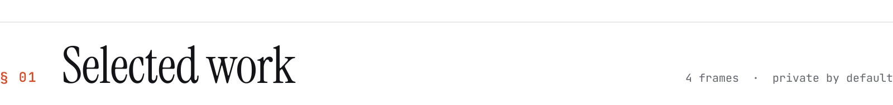
</picture>

Most of my work is private: products in development and other confidential work. These are case studies, not code tours. I'm happy to walk through any of them in a conversation.

<picture>
  <source media="(prefers-color-scheme: dark)" srcset="assets/projects/01-robor-learning-dark.svg">
  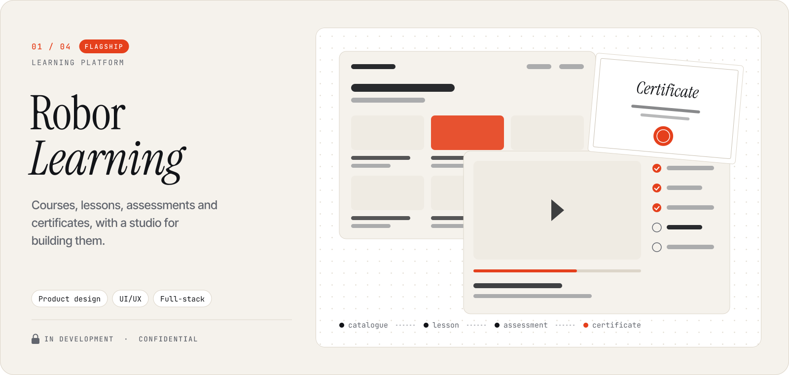
</picture>

### Robor Learning · FLAGSHIP

My flagship project. An online learning platform: learners move from a course catalogue through lessons and assessments to a certificate, and an admin studio lets the team build and publish that content.

- **Designed the whole journey**: catalogue → lesson → assessment → certificate, plus onboarding and account flows.
- **Built the studio side too**: step-by-step builders for courses, curricula and assessments.
- **Engineered to be trusted**: a typed domain model, automated tests and CI that checks every change.

`React` · `TypeScript` · `TanStack Start` · `Tailwind CSS` · `shadcn/ui` · `Supabase` · `Vitest`

IN DEVELOPMENT · CONFIDENTIAL CASE STUDY

---

<picture>
  <source media="(prefers-color-scheme: dark)" srcset="assets/projects/02-angkor-scroll-dark.svg">
  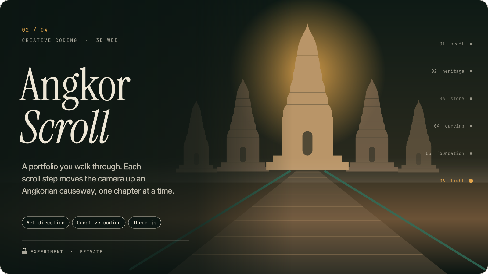
</picture>

### Angkor Scroll · CREATIVE CODING

My creative coding project: a portfolio you walk through. The page is a dusk walk up an Angkorian temple causeway. Each scroll moves the camera forward, each stop is a chapter of my work, and the whole journey builds to a single moment when the central tower lights up.

<picture>
  <source media="(max-width: 600px) and (prefers-color-scheme: dark)" srcset="assets/projects/02-angkor-scroll-storyboard-mobile-dark.svg">
  <source media="(max-width: 600px)" srcset="assets/projects/02-angkor-scroll-storyboard-mobile-light.svg">
  <source media="(prefers-color-scheme: dark)" srcset="assets/projects/02-angkor-scroll-storyboard-dark.svg">
  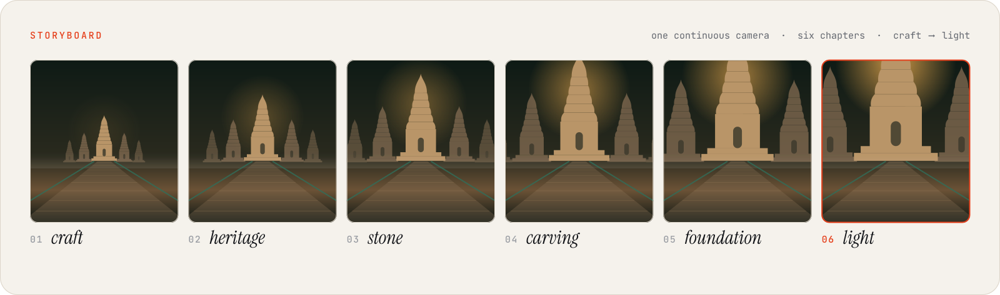
</picture>

- **Story before scroll**: six chapters (craft → heritage → stone → carving → foundation → light), one continuous scene instead of stacked sections.
- **Art-directed like a brand**: its own palette of sandstone, jungle ink, naga jade and a single ember accent, kept for the one payoff moment.
- **Built as a 3D scene in the browser**, designed for native, fully reversible scrolling, with no scroll-jacking.
- **Heritage as a design language**, not as decoration.

`React` · `Three.js` · `React Three Fiber` · `Tailwind CSS`

EXPERIMENT · PRIVATE · STORYBOARD ABOVE IS AN ILLUSTRATION OF THE CONCEPT

---

<picture>
  <source media="(prefers-color-scheme: dark)" srcset="assets/projects/03-vr-spotbuy-dark.svg">
  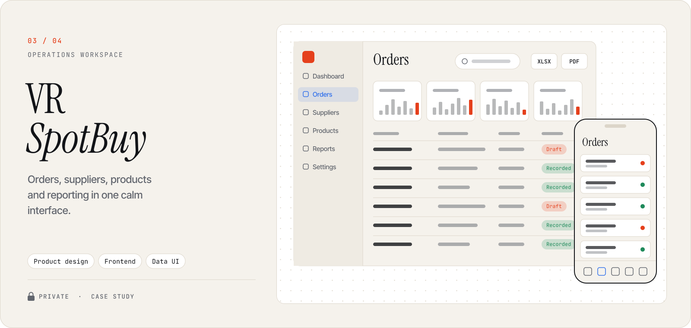
</picture>

### VR SpotBuy

An operations workspace for purchasing: orders, suppliers, products and reporting in one calm, dense-but-readable interface.

- **Feature-by-feature architecture**: each business area is its own module, so the product can grow without tangling.
- **Desktop and mobile**: a sidebar layout on desktop and a bottom-navigation layout on phones.
- **Reports that export to Excel and PDF.**

`React` · `TypeScript` · `Vite` · `Tailwind CSS` · `Figma Make`

PRIVATE · CASE STUDY

---

<picture>
  <source media="(prefers-color-scheme: dark)" srcset="assets/projects/04-robor-hr-ecosystem-dark.svg">
  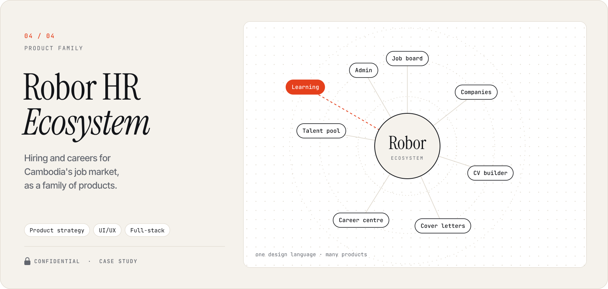
</picture>

### Robor HR Ecosystem

A family of products for hiring and careers in Cambodia: a job board and company profiles, CV and cover-letter builders, a career centre, and an admin workspace, with Robor Learning as its sibling.

- **Product thinking across surfaces**: job seekers, employers and admins each get a purpose-built experience.
- **One design language, many products**, so the whole family feels like a single brand.

`React` · `TypeScript` · `TanStack` · `Tailwind CSS` · `Supabase`

CONFIDENTIAL · CASE STUDY

---

<picture>
  <source media="(prefers-color-scheme: dark)" srcset="assets/sections/02-toolkit-dark.svg">
  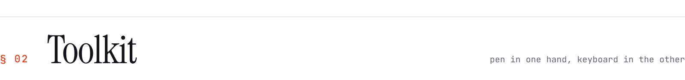
</picture>

The tools behind the work above.

<picture>
  <source media="(max-width: 600px) and (prefers-color-scheme: dark)" srcset="assets/toolkit/toolkit-mobile-dark.svg">
  <source media="(max-width: 600px)" srcset="assets/toolkit/toolkit-mobile-light.svg">
  <source media="(prefers-color-scheme: dark)" srcset="assets/toolkit/toolkit-dark.svg">
  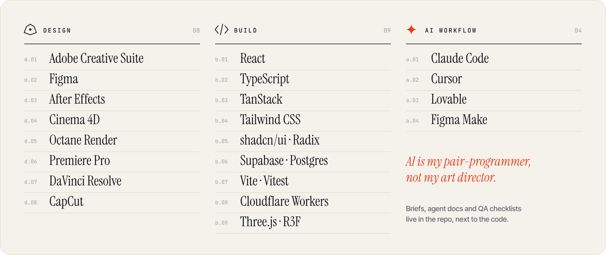
</picture>

---

<picture>
  <source media="(prefers-color-scheme: dark)" srcset="assets/sections/03-now-building-dark.svg">
  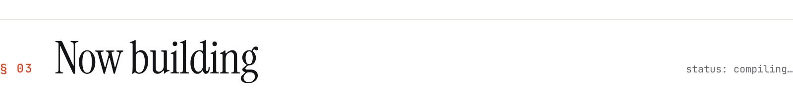
</picture>

- **Robor Learning**: polishing the learner experience on the way to launch.
- **Angkor Scroll**: turning my portfolio into a place you walk through.
- **My AI-assisted workflow**: briefs, agent docs and QA checklists that live in the repo, so one designer can ship with the discipline of a small team.

---

<picture>
  <source media="(prefers-color-scheme: dark)" srcset="assets/sections/04-design-code-dark.svg">
  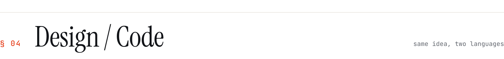
</picture>

The same ideas, in two languages:

| In design | In code |
| :-- | :-- |
| UI/UX & product design | Frontend architecture & components |
| Typography & layout | Design tokens & CSS |
| Motion & 3D | Animation & WebGL / Three.js |
| Campaigns & storytelling | AI-powered creative workflows |

---

<picture>
  <source media="(prefers-color-scheme: dark)" srcset="assets/sections/05-activity-dark.svg">
  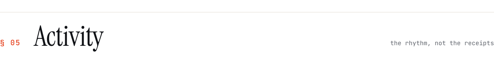
</picture>

Most of what I build lives in private repositories, so the contribution graph below shows the rhythm of the work rather than the receipts. The case studies above tell the story.

---

<picture>
  <source media="(prefers-color-scheme: dark)" srcset="assets/sections/06-contact-dark.svg">
  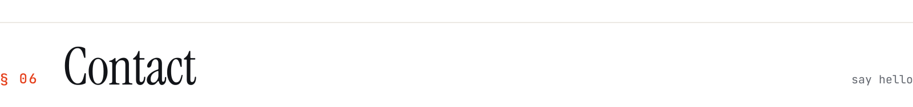
</picture>

<picture>
  <source media="(prefers-color-scheme: dark)" srcset="assets/signoff/signoff-dark.svg">
  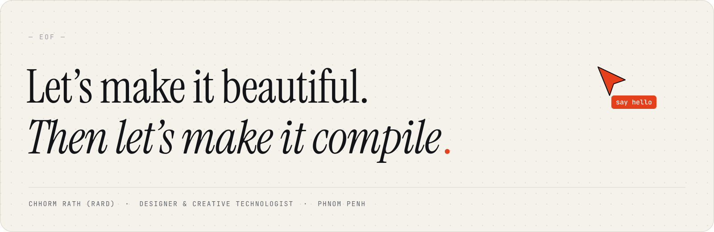
</picture>

Have a product, a brand or a strange idea that needs both a designer and a developer? LinkedIn is the best place to reach me.

**[Message me on LinkedIn →](https://www.linkedin.com/in/rath-chhorm-757109178)**

Every graphic here was drawn as SVG and set in Instrument Serif, Inter Tight &amp; JetBrains Mono. Phnom Penh, Cambodia.
